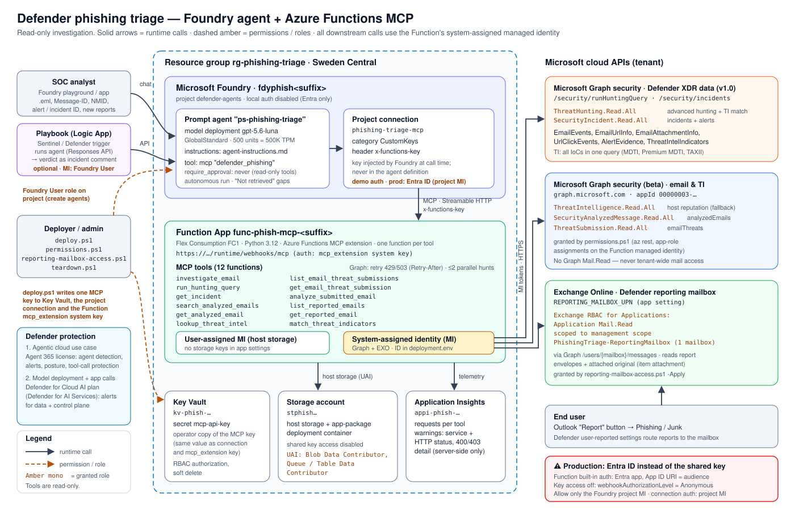

# Defender phishing triage (Foundry + Azure Functions MCP)

A Foundry agent that triages reported phishing using a read-only Defender MCP server hosted on Azure Functions. Public networking only: no VNet or private endpoints.

> [!IMPORTANT]
> **Demo/lab setup.** The MCP endpoint is protected by a shared key (`x-functions-key`, the Functions MCP extension's `mcp_extension` system key). For production, use Entra ID instead. See [Production: Entra ID authentication](#production-entra-id-authentication).

## Architecture



| Component | Details |
|---|---|
| Foundry | `AIServices` account in `swedencentral`, with a project, a model deployment and a prompt agent |
| Function App | Linux, Python 3.12, Flex Consumption. MCP server at `/runtime/webhooks/mcp` (Streamable HTTP) built on the [Functions MCP extension](https://learn.microsoft.com/azure/azure-functions/functions-bindings-mcp). Each tool is its own `mcpToolTrigger` function, so you get logs and failures per tool |
| Auth to MCP | `x-functions-key` = deployment MCP key. Also stored in Key Vault (operator copy) and in the Foundry project connection |
| Upstream auth | The system-assigned managed identity calls Graph (Defender and TI data). A separate user-assigned identity gives the host data-plane access to Storage; no storage key is stored in app settings |
| Supporting | Storage (no public blob access), Key Vault, Application Insights. HTTPS only |

Tool errors are returned as `{"error": ...}` and include only the service name and HTTP status. Upstream response bodies are logged on the server and never returned.

## Tools

| Tool | Purpose |
|---|---|
| `investigate_email` | Pivot from `network_message_id` (alias `network_session_id`), `internet_message_id`, `alert_id` or `incident_id` into Defender incident/alert data and `EmailEvents`, `EmailUrlInfo`, `EmailAttachmentInfo`, `UrlClickEvents`, `AlertEvidence`. Checks up to 50 URLs/domains/IPs, plus attachment SHA256 hashes and sender addresses, against TI in one query. Never reads mailbox content |
| `get_incident` | Full Defender XDR incident and its alerts by ID |
| `run_hunting_query` | Read-only Advanced Hunting KQL. The query must bound `Timestamp` and pivot on known entities. One query per call, no `externaldata`, max 20,000 characters. A `take` limit is appended (500 default, 1,000 max) and results are capped at 600 KB |
| `search_analyzed_emails` / `get_analyzed_email` | Graph beta `analyzedEmails`: verdicts, authentication results, URLs and attachments. Search needs a time window of up to 90 days plus a NetworkMessageId or recipient filter. Up to 50 indicators are checked against TI. Metadata only, no message body |
| `list_email_threat_submissions` / `get_email_threat_submission` | Graph beta `emailThreats` submission records. Metadata and status only |
| `analyze_submitted_email` | Parses a raw `.eml` (max 1 MB): headers, text/HTML body (max 80,000 characters each) and attachment names and types. Up to 50 indicators are checked against TI; non-public IPs and invalid values are skipped, with the reason given |
| `get_reported_email` | Finds a report in the mailbox pinned by `REPORTING_MAILBOX_UPN` by exact RFC `Message-ID`, parses the attached `.eml` and checks its IoCs against TI. Callers cannot choose the mailbox. Returns a not-configured error if the setting is empty |
| `list_reported_emails` | Headers of reports received in a time window (default 60 minutes, max 7 days, up to 100 reports) |
| `match_threat_indicators` | Matches up to 100 values per type (`domains`, `ips`, `urls`, `sha256`, `emails`) against `ThreatIntelIndicators` in one query. Values are normalized and escaped. Domains also match on parent domains, and full URLs match including their query string. Only active, unrevoked, unexpired indicators count |
| `lookup_threat_intel` | Fallback for a single host: Defender TI host reputation for a domain or IP (for a URL, its host is checked) |

**Agent workflow** ([`agent-instructions.md`](agent-instructions.md)):
1. Parse the submitted `.eml` first (TI checks run automatically).
2. Pivot into Defender: an alert or incident ID you provide wins; otherwise use the embedded NetworkMessageId, then the RFC Message-ID.
3. Run hunting pivots only as each condition calls for them.
4. For an incident, classify every alert as email-related (covered) or not. With several messages, the worst message verdict wins.
5. Return the report, ending with one fenced `json` block: an incident-update proposal (status, classification, determination, severity, tags, comment, `scope_complete`, `uncovered_alert_ids`). It never proposes `resolved` for an incomplete scope. The agent changes nothing itself.

Without a usable identifier, the agent reports that it could not correlate with Defender and still analyzes the content. The workflow adapts email, IoC and incident patterns (evidence-only reporting, verdict gates) from [SCStelz/security-investigator](https://github.com/SCStelz/security-investigator). It is a new instruction file written for this scope, not a copy.

## Prerequisites and behavior

**Model.** `gpt-5.6-luna` must be available in Sweden Central for your subscription. The SKU defaults to `GlobalStandard` (set in `main.bicep`). If the model is unavailable, deployment fails rather than quietly picking another model. Capacity is 500 = 500K TPM. Each model call in a run resends the whole context, so large incidents can hit `rate_limit_exceeded` (token rate limit). Raise `modelCapacity` or keep tool outputs small.

**Defender data via Graph only.** Hunting uses `POST /security/runHuntingQuery` and incidents use `GET /security/incidents/{id}?$expand=alerts` (v1.0). The legacy `api.security.microsoft.com` is not used. The email tables require Defender for Office licensing and telemetry. Graph app roles for the managed identity, assigned by `permissions.ps1`: `ThreatHunting.Read.All`, `SecurityIncident.Read.All`, `ThreatIntelligence.Read.All`, `SecurityAnalyzedMessage.Read.All`, `ThreatSubmission.Read.All`.

**Beta APIs.** Threat Intelligence, `analyzedEmails` and `emailThreats` use Graph beta, which can change and is not supported in production. Check these routes in your tenant before relying on them.

**Reporting mailbox (optional).**
- Off until `REPORTING_MAILBOX_UPN` is set and an admin runs `reporting-mailbox-access.ps1 -Apply`.
- Access uses Exchange Application RBAC `Application Mail.Read`, scoped to that one mailbox. Do **not** add Entra Graph `Mail.Read` / `Mail.ReadBasic.All`: an unscoped permission defeats the scope.
- Route Defender user-reported messages to this mailbox and register it as a SecOps mailbox in the advanced delivery policy.
- Only `.eml` attachments are supported, and each must be the unmodified original, not forwarded. The tool scans up to 100 report envelopes (7-day window, up to 30 days with `received_after`) and needs the exact `Message-ID`. If it finds no match, gets a `.msg`, or exceeds these limits, it reports a coverage gap and does not widen the search.
- Permission changes take 30 minutes to 2 hours to propagate.

**TI matching.**
- All email tools check their IoCs in one hunting query against `ThreatIntelIndicators` (Sentinel TI: MDTI, TAXII, custom feeds), not one Graph call per host. The query runs inside your tenant, so full URLs with query strings never leave it.
- This requires a Sentinel workspace onboarded to the Defender portal with TI connectors. Without it, the tools fall back to the per-host Graph reputation API.
- `no match` only means the value is not a known indicator. It does not mean the value is safe.
- **Skipped domains:** `microsoft.com`, `microsoftonline.com`, `office365.com`, `outlook.com`, `aka.ms` and their subdomains are not checked, and appear in the report as `skipped: well-known domain`. `forms.microsoft.com`, `*.onmicrosoft.com` and `*.sharepoint.com` are always checked, because anyone can get such a name. `office.com`, `live.com`, `linkedin.com`, `google.com` and `youtube.com` are deliberately checked because they host user content or open redirects. To change the list, set `TI_SKIP_DOMAINS` (replaces it) or `TI_SKIP_DOMAINS_EXTRA` (adds to it).
- **Fallback cache:** each worker caches results for 1 hour (`TI_CACHE_TTL_SECONDS`; `0` turns caching off). Concurrent lookups of the same host share one request. Only answers are cached, never errors or 429s. The cache is per instance and is lost on restart.

**Hunting pivots.** Adapted from [`email_threat_detection.md`](https://github.com/SCStelz/security-investigator/blob/main/queries/email/email_threat_detection.md), [`aitm_threat_detection.md`](https://github.com/SCStelz/security-investigator/blob/main/queries/identity/aitm_threat_detection.md) and [`cloudappevents_exploration.md`](https://github.com/SCStelz/security-investigator/blob/main/queries/cloud/cloudappevents_exploration.md):
- Sender and campaign spread, including other messages sharing the same URL. The campaign query is aggregated (top 25 sender/subject/delivery groups, not raw rows) and skipped for well-known first-party and tenant-internal senders
- Delivery and ZAP state
- Clicks on the investigated message
- Click followed by a risky sign-in (`EntraIdSignInEvents`)
- Spread of the attachment hash
- Narrow mailbox activity after a click

They run only when a condition calls for them, never all at once. Queries use `Timestamp` because this is XDR, not Sentinel (`TimeGenerated`); Sentinel-only tables are excluded.

## Production: Entra ID authentication

A shared key carries no caller identity, gives no audit trail per caller and must be rotated by hand. Switch to Entra ID:

1. **Enable App Service Authentication** with Entra ID. Use an app registration whose Application ID URI (for example `api://<function-app>`) is the allowed audience. The portal shortcut is *AI (preview) → Turn on MCP authentication*.
2. **Turn off key auth:** set `AzureFunctionsJobHost__extensions__mcp__system__webhookAuthorizationLevel=Anonymous`.
3. **Allow only the Foundry project's managed identity** to call the endpoint.
4. **Foundry connection:** replace the `CustomKeys` connection with a project-managed-identity MCP connection: `azd ai connection create … --kind remote-tool --auth-type project-managed-identity --audience api://<function-app>`. If tools must act as the signed-in user, use OAuth identity passthrough.
5. **Remove the key path:** the `mcp-api-key` secret, the `mcp_extension` key step in `deploy.ps1`, and the `mcpApiKey` parameter.

Also: private endpoints or network restrictions for the Function App, Key Vault and Storage, and a suitable `require_approval` policy for the tools.

Refs: [Functions MCP built-in auth](https://learn.microsoft.com/azure/azure-functions/functions-mcp-tutorial) · [Foundry: build your own MCP server](https://learn.microsoft.com/azure/foundry/mcp/build-your-own-mcp-server) · [Foundry MCP authentication](https://learn.microsoft.com/azure/foundry/agents/how-to/mcp-authentication)

## Protect the agent with Defender

The agent reads attacker-controlled mail and has read access to Defender data, so treat it as an attack surface. Since July 1, 2026, protection for Foundry agents comes with Agent 365.

| Layer | Covers | Applies to |
|---|---|---|
| Cloud agents (Defender portal, **Agent 365 license**) | Agent inventory and posture, threat detection on agent activity (preview), real-time checks on tool calls before they run | This Foundry agent |
| **Defender for AI Services** (Defender for Cloud AI plan) | Data-plane and control-plane activity: prompt injection, data leakage, control-plane alerts | The model deployment |
| Defender for Endpoint | Runtime protection for agents on endpoints | Local agents |

To enable: Defender portal > **Settings** > **Security for AI** > **Security for AI Agents**. Advanced hunting tables: `AgentsInfo` (inventory) and `BehaviorInfo` (real-time protection).

Refs: [Agent security moves to Agent 365](https://learn.microsoft.com/defender-xdr/security-for-ai/transition-agent-security-to-agent-365) · [AI agent inventory](https://learn.microsoft.com/defender-xdr/security-for-ai/ai-agent-inventory) · [Agent 365 + Foundry](https://learn.microsoft.com/azure/foundry/agents/concepts/agent-365-integration)

## Deploy

**Requires:** Azure CLI, Bicep CLI, Azure Functions Core Tools v4, Python 3.12, Foundry model access, and a tenant admin for the app-role grants. [`PERMISSIONS.md`](PERMISSIONS.md) lists the operator roles each script needs.

### 1. Infrastructure, code and agent

```powershell
./deploy.ps1              # prints the plan and asks to confirm
./deploy.ps1 -Yes         # no prompts (automation)
./deploy.ps1 -ReportingMailbox reports@contoso.com   # '-' disables
./deploy.ps1 -AgentName <name> -ProjectName <name>   # a new name creates a separate project/agent
./deploy.ps1 -RotateKey   # new MCP key (default: reuse the one in Key Vault)
./deploy.ps1 -ForceCode   # redeploy function/ even if unchanged
./deploy.ps1 -AgentOnly   # only publish a new agent version
```

All inputs are optional. The subscription comes from the current `az` context. Names you don't set are generated deterministically from the subscription and resource group (`rg-phishing-triage`, `fdyphish<suffix>`, `func-phish-mcp-<suffix>`). The project and agent default to `defender-agents` / `ps-phishing-triage`. To override, set `AZURE_SUBSCRIPTION_ID`, `AZURE_RESOURCE_GROUP`, `FOUNDRY_NAME`, `FUNCTION_APP_NAME`, `LOCATION`, `PROJECT_NAME`, `AGENT_NAME`, `FOUNDRY_MODEL_VERSION`, `MCP_API_KEY` or `REPORTING_MAILBOX_UPN`.

**Plan output.** The script prints this before it changes anything:

```text
Deployment plan
  Subscription        <name> (<id>)  (current az context)
  Resource group      rg-phishing-triage  (default, new)
  Foundry account     fdyphish3f9a2c  (generated (deterministic), new)
  Foundry project     defender-agents  (default)
  Function App        func-phish-mcp-3f9a2c  (generated (deterministic), new)
  Agent               ps-phishing-triage  (default, new version)
  Reporting mailbox   reports@contoso.com  (entered now)
  MCP key             ********  (reused from Key Vault kv-phish-… - unchanged)
  Function code       E7DF1CB8D95F  (unchanged - skipped (-ForceCode to redeploy))
```

The text in brackets shows where each value came from (`environment`, `deployment.env`, `current az context`, `default`, `generated`, `parameter`) and whether the resource is `new` or will be updated. A yellow `[!]` means the project or agent name differs from the current deployment.

**Re-runs are idempotent:**

| Part | Re-run behavior |
|---|---|
| Names | Taken from `deployment.env`; otherwise the same deterministic names |
| Bicep | Incremental update |
| MCP key | Reused from Key Vault. Rotated only with `-RotateKey`, with `MCP_API_KEY`, or if the vault can't be read |
| Function code | Redeployed only when the SHA-256 of `function/` changes (`FUNCTION_CODE_SHA256`) or with `-ForceCode` |
| Agent | New version only if the instructions or tool definition changed. `AGENT_NAME` and `AGENT_VERSION` are written to `deployment.env`, also with `-AgentOnly` |
| Logic App | If `LOGIC_APP_NAME` is set and the agent or project name changed, `deploy-logicapp.ps1` runs automatically. New agent versions need no redeploy |
| Roles and grants | Existing assignments are skipped |

**What the script does:**
- Grants the signed-in user `Foundry User` on the project and `Key Vault Secrets User` on the vault. With a service principal login, these grants are skipped and must be assigned separately.
- Builds the Function remotely, sets the `mcp_extension` key and creates the prompt agent. The agent uses `agent-instructions.md` and an MCP tool bound to the `phishing-triage-mcp` connection (custom keys, `x-functions-key`).
- Passes the key as a secure ARM parameter through a temporary file readable only by the current user, deleted in `finally`. If the host crashes, that file can be left behind, so protect the host's temp directory.
- Requires a random key of at least 43 characters.
- Does **not** grant Graph access. Run step 2 for that.

### 2. Graph app roles (Entra admin)

Run as an Entra admin who can assign app roles, such as a Privileged Role Administrator. The script uses `az rest`, so it needs no Graph PowerShell modules. It assigns the roles listed above, skips roles already assigned and removes leftover roles on the legacy Defender APIs.

```powershell
./permissions.ps1   # managed identity taken from deployment.env, or -FunctionPrincipalId <object-id>
```

### 3. Reporting mailbox access (optional, Exchange admin)

First configure [user-reported message settings](https://learn.microsoft.com/defender-office-365/submissions-user-reported-messages-custom-mailbox). By default the script uses the mailbox configured there (`Get-ReportSubmissionRule` `SentTo`) and warns if `-MailboxUpn` differs from it.

```powershell
./reporting-mailbox-access.ps1          # preview only
./reporting-mailbox-access.ps1 -Apply   # apply and verify; control mailbox auto-selected or -ControlMailboxUpn
```

- With `-Apply`, the script grants scoped [Application RBAC](https://learn.microsoft.com/exchange/permissions-exo/application-rbac) access. It then verifies the grant: in scope for the reporting mailbox, out of scope for a control mailbox. It refuses to run if the identity already holds broad Graph mail roles.
- It installs `ExchangeOnlineManagement` for the current user if the module is missing. Sign-in is interactive and falls back to device code. To always use device code, pass `-UseDeviceCode` or set `EXO_USE_DEVICE_CODE=1`. Each run signs in again.
- Afterwards, set `REPORTING_MAILBOX_UPN` and redeploy.
- If only a Defender ID is known, the agent looks up `InternetMessageId` via `EmailEvents` and then calls `get_reported_email`. It never widens the mailbox search.

### 4. Logic App (optional)

A Consumption Logic App that runs the agent for one incident and parses its JSON proposal. It is read-only: it does not update the incident.

```powershell
./deploy-logicapp.ps1                    # names from deployment.env
./deploy-logicapp.ps1 -AgentName <name>  # point it at another agent
```

- Name: `ps-logic-phish-triage-<suffix>`. Its managed identity gets `Foundry User` on the project.
- **Run:** Portal > Logic App > **Run with payload**, method `POST`, header `incidentId` = `12345`. A query parameter `incidentId` or the body `{"incidentId": "12345"}` also work. Only numeric IDs are accepted.
- **Flow:** calls the Responses API with `agent_reference` and `background: true`, polls every 15 s (max 20 min), extracts the last ```` ```json ```` block and validates it against the schema.
- **Output:** the `Result` action holds `proposal`, `report` and `gate`:
  - `closeAllowed` is true only for status `resolved` with `scope_complete`, no uncovered alerts, `high` confidence and a matching `incident_id`.
  - `effectiveStatus` downgrades `resolved` to `inProgress` otherwise.
  - `requiresApproval` flags a `benign` close for human approval.

## Files

| File | Purpose |
|---|---|
| `deploy.ps1` | Deploys the infrastructure, Function code and agent |
| `deploy-logicapp.ps1` | Deploys the triage Logic App |
| `logicapp/` | Logic App Bicep (`logicapp.bicep`) and workflow definition (`workflow.json`) |
| `permissions.ps1` | Assigns the Graph app roles to the Function identity |
| `reporting-mailbox-access.ps1` | Previews or applies Exchange RBAC scoped to the reporting mailbox |
| `teardown.ps1` | Deletes the resource group, purges Key Vault and Foundry, and deletes Entra Agent ID objects (prefix `<foundry-name>-`). Flags: `-IncludeExchange`, `-EntraOnly -FoundryName <name>`, `-PurgeEntra` (permanent, not restorable for 30 days), `-Force` |
| `main.bicep` | Azure resources |
| `parameters.example.json` | Shape of the non-secret parameters |
| `function/` | Python MCP server |
| `agent-instructions.md` | Agent workflow, hunting pivots, report format |
| `PERMISSIONS.md` | Operator roles needed for each script |
| `architecture.svg` | Diagram |
| `deployment.env` | Written by `deploy.ps1`; contains no secrets and is git-ignored. Re-runs and teardown read it. Archived as `deployment.env.removed-<timestamp>` after teardown |

`deployment.env` keys:

| Group | Keys |
|---|---|
| Context | `DEPLOYED_AT_UTC`, `AZURE_TENANT_ID`, `AZURE_SUBSCRIPTION_ID`, `AZURE_RESOURCE_GROUP`, `LOCATION` |
| Foundry | `FOUNDRY_NAME`, `FOUNDRY_PROJECT_NAME`, `FOUNDRY_PROJECT_ENDPOINT`, `FOUNDRY_PROJECT_RESOURCE_ID`, `MODEL_DEPLOYMENT`, `MODEL_VERSION`, `MCP_CONNECTION_NAME`, `AGENT_NAME`, `AGENT_VERSION` |
| Function | `FUNCTION_APP_NAME`, `FUNCTION_PLAN_NAME`, `MCP_ENDPOINT`, `FUNCTION_PRINCIPAL_ID`, `FUNCTION_APP_ID`, `FUNCTION_CODE_SHA256` |
| Supporting | `KEY_VAULT_NAME`, `STORAGE_ACCOUNT_NAME`, `STORAGE_IDENTITY_NAME`, `APP_INSIGHTS_NAME` |
| Mailbox | `REPORTING_MAILBOX_UPN`, `EXCHANGE_SCOPE_NAME`, `EXCHANGE_ROLE_ASSIGNMENT_NAME` |
| Logic App | `LOGIC_APP_NAME` (written by `deploy-logicapp.ps1`, kept by `deploy.ps1`) |

## Limitations

This is starter IaC that has not been deployed in your subscription. Validate the following in your tenant:
- Model availability and quota
- API permissions and Graph TI entitlement
- Defender schema
- Foundry MCP connection behavior

The alert-to-email pivot relies on `AlertEvidence.AdditionalFields.NetworkMessageId`; if your tenant's evidence uses a different shape, adjust that mapping. There is no private networking, and there are no write or remediation tools. The Logic App only proposes incident updates; applying them (Graph `PATCH /security/incidents/{id}`, needs `SecurityIncident.ReadWrite.All`) is not included.
